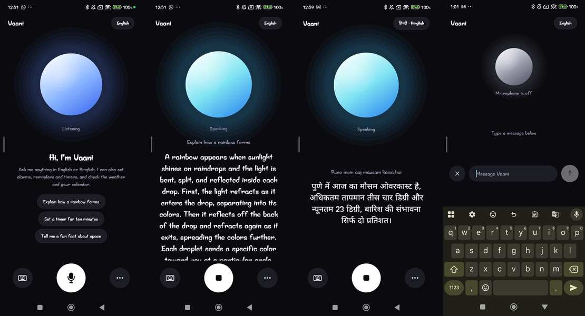
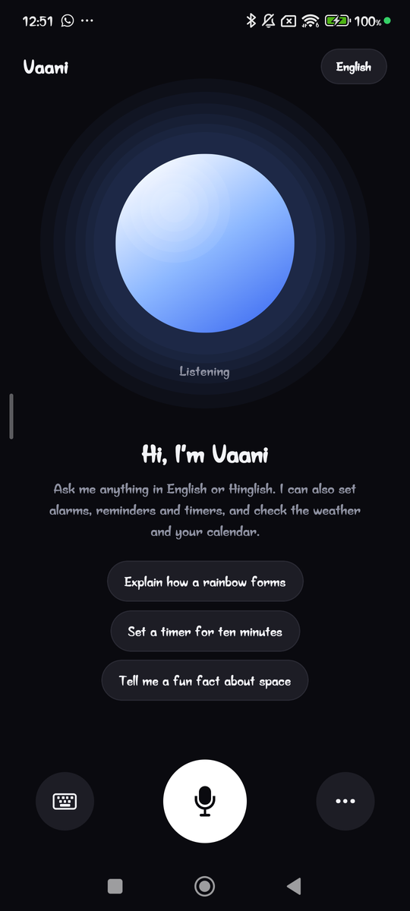
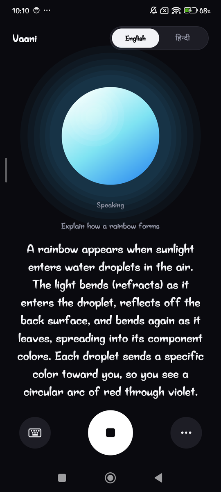
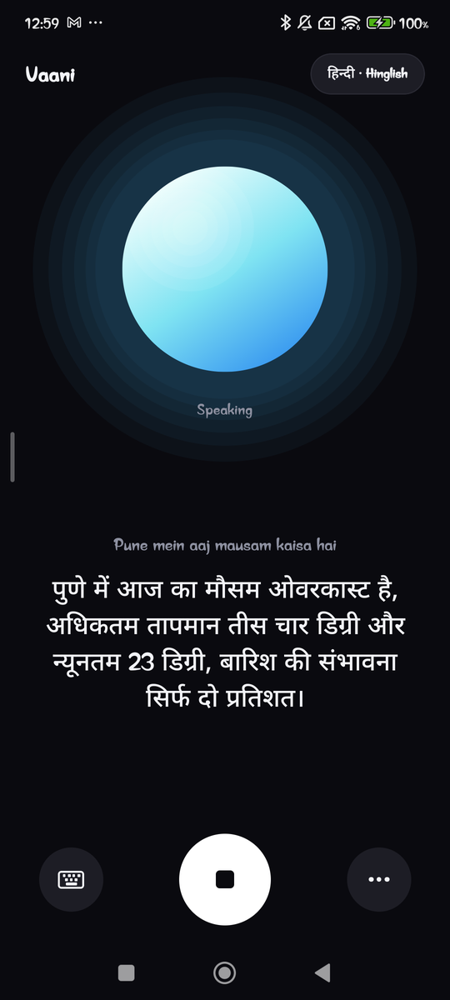
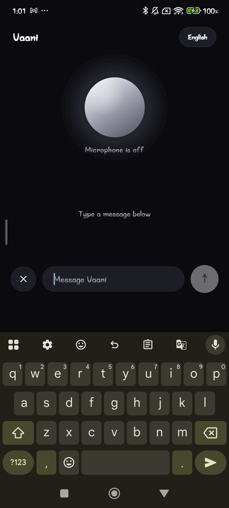
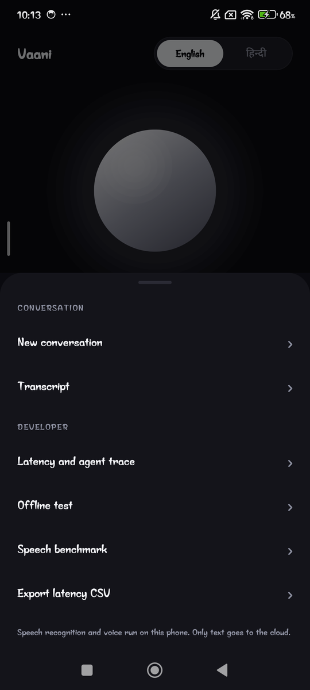
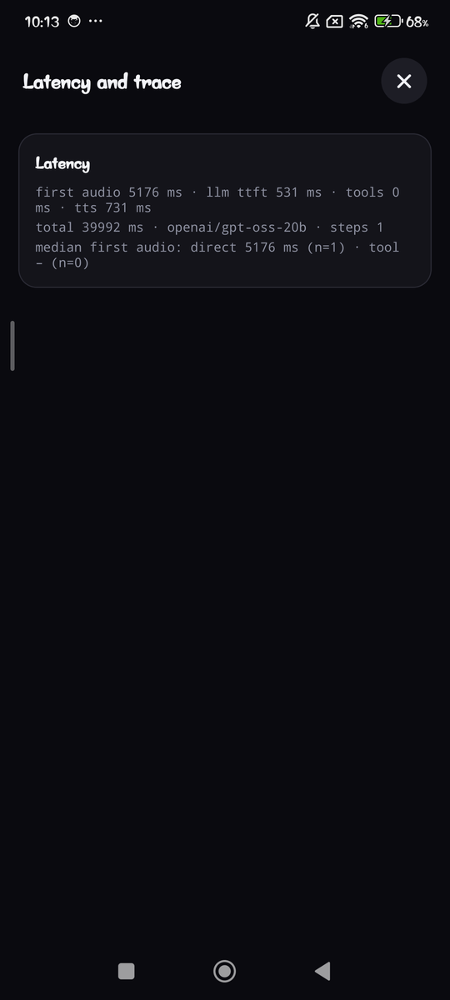

<h1 align="center">Vaani</h1>

<p align="center">
  A voice assistant for Android that speaks English and Hinglish.<br/>
  Speech recognition and the voice run on the phone. Only text goes to the cloud.
</p>

<p align="center">
  <a href="https://github.com/Jivit87/Vaani/actions/workflows/ci.yml"></a>
</p>

<p align="center">
  
</p>

Vaani is a voice-mode chat assistant, in the spirit of ChatGPT's voice screen. Talk to it, or type. Ask it anything (facts, explanations, maths, translation, advice, stories), or have it set alarms, timers and reminders, read your calendar and check the weather. It answers out loud and shows live captions.

## What it does

- **Talks both ways, on the phone.** Silero VAD finds the end of your sentence, Whisper-small (int8) transcribes it, and a Piper voice speaks the reply. No audio leaves the device.
- **English and Hinglish.** One toggle switches what it listens for and what it answers in. Hindi comes out in Devanagari.
- **Acts, not just chats.** Alarm, timer and reminder, calendar read, weather (Open-Meteo), exact maths, and Wikipedia lookups for facts it might not know.
- **Asks when it has to.** "Alarm laga do" gets a "kitne baje?" instead of a guess, and follow-ups like "aur kal?" work.
- **Never claims what it didn't do.** If a tool fails, it says so. If the model returns nothing, it asks you to repeat, instead of saying "done".
- **Keeps working when things go wrong.** Network loss, rate limits and bad tool arguments all end in a short spoken message, and the mic always comes back on.

## Screenshots

|                         Home                          |                         Speaking                          |                         Hinglish                          |
| :---------------------------------------------------: | :-------------------------------------------------------: | :-------------------------------------------------------: |
|  |  |  |

|                         Typing                          |                         Menu                          |                    Latency and trace                     |
| :-----------------------------------------------------: | :---------------------------------------------------: | :------------------------------------------------------: |
|  |  |  |

The orb shows what Vaani is doing: blue while listening, violet while thinking, cyan while speaking, grey when the mic is muted. Screenshots are from a Redmi Note 12 Pro 5G.

## How it works

```
 mic ─▶ Silero VAD ─▶ Whisper-small (on device) ─▶ text
                                                     │
                      ┌──────────────────────────────▼───────────────────────────┐
                      │ agent loop (max 3 steps)                                 │
                      │   memory: last 6 turns + rolling summary + state         │
                      │   LLM (Groq or NVIDIA, streamed) ◀──▶ tools              │
                      └───────────────┬──────────────────────────────────────────┘
                                      │ tokens, as they arrive
                                      ▼
                  sentence chunker ─▶ text cleanup ─▶ Piper (on device) ─▶ speaker
```

- **Sentence by sentence.** The first sentence is spoken while the model is still writing the second, and the next one is already being synthesized while the current one plays.
- **Half duplex.** The mic is off while Vaani speaks, and it reopens only after the player buffer has drained. Short transcripts that only repeat Vaani's own words are dropped as echo.
- **Small, bounded memory.** Recent turns, a short summary of older ones, and a small state record written by the tools (so "aur kal?" does not depend on the model remembering).
- **The LLM is untrusted.** Tool arguments are validated (types, ranges, real dates, future-only reminders), maths goes to a safe parser instead of the model, and nothing the model writes reaches the speaker unfiltered.

More detail in [`docs/ARCHITECTURE.md`](docs/ARCHITECTURE.md), and the reasoning behind each choice in [`docs/DECISIONS.md`](docs/DECISIONS.md).

## Numbers

All measured on a Redmi Note 12 Pro 5G (Android 14, 5.5 GB RAM) unless stated.

| Thing                                              | Result                                                                                             |
| -------------------------------------------------- | -------------------------------------------------------------------------------------------------- |
| Tool-calling eval, `gpt-oss-120b` on Groq (laptop) | 100% tool choice, 100% arguments, 100% clarification on 27 cases. First token about 0.7 s.         |
| Same eval, noisy transcripts added (35 cases)      | 100% / 97% / 100%                                                                                  |
| General-assistant cases, `gpt-oss-20b`             | 96% tool choice, 100% plain-speech and length checks, first token about 0.5 s                      |
| Voice speed: Piper                                 | synthesizes at about 0.2x real time, around 1% silence between sentences in a long reply           |
| Voice speed: Kokoro                                | about 1.5x real time, around 40% silence in a long reply, so it is an opt-in "Natural" voice       |
| First audio, a weather question                    | about 3.8 s on one phone hotspot run (LLM 0.5 s, tool 2.7 s, voice 1 s). One sample, not a median. |

Full tables and the failures are in [`eval/results.md`](eval/results.md).

## Run it

You need Node 20, JDK 17, the Android SDK with the NDK, `adb`, and a phone (Android 10 or newer, 6 GB RAM or more recommended, about 1 GB free). The speech runtime is native, so this does not run in Expo Go.

```bash
npm ci                         # also applies the nitro-voice patches
cp .env.example .env           # add a free Groq key (or an NVIDIA key)
npm run prebuild               # generates ./android
npm run android                # builds a dev client and installs it on the connected phone
```

The first launch downloads the voice models once (about 540 MB with both languages, so use Wi-Fi). After editing `.env`, restart Metro with `npx expo start --clear`, because Expo inlines those values at build time.

For latency numbers and demos use a release build: `npm run android:release`.

### Keys and providers

| Variable                     | What it does                                                     |
| ---------------------------- | ---------------------------------------------------------------- |
| `EXPO_PUBLIC_GROQ_API_KEY`   | free key from <https://console.groq.com/keys> (default provider) |
| `EXPO_PUBLIC_NVIDIA_API_KEY` | key from <https://build.nvidia.com>, an alternative provider     |
| `EXPO_PUBLIC_LLM_PROVIDER`   | `groq` or `nvidia`                                               |
| `EXPO_PUBLIC_TTS_ENGINE`     | `piper` (default, fast) or `kokoro` (richer, slower)             |

The Groq free tier is about 200,000 tokens a day on the main model, roughly 150 to 190 requests. Vaani skips a rate-limited model for its cooldown, falls back to the smaller one, and says so out loud if both are used up. See [`docs/DECISIONS.md`](docs/DECISIONS.md) (D19).

## Commands

| Command                                 | What it does                                                |
| --------------------------------------- | ----------------------------------------------------------- |
| `npm run check`                         | typecheck, eslint, prettier and all tests                   |
| `npm test`                              | Vitest, runs in Node, no phone needed                       |
| `npm run eval:tools`                    | tool-calling and general-assistant eval against live models |
| `python3 benchmarks/run_wer.py`         | word error rate from the in-app STT benchmark export        |
| `python3 scripts/gen_model_manifest.py` | refresh model file lists and sizes from Hugging Face        |

## Project layout

```
App.tsx           entry: first-run download, then the voice screen
src/agent/        turn loop, memory, tool runner, safe calculator
src/llm/          streaming client, fallback and cooldowns, prompt, tool schemas
src/tts/          sentence chunker, number and time speech, Hindi and loanword respelling
src/pipeline/     voice agent state machine, speech queue, echo and noise filters, metrics
src/speech/       nitro-voice adapters, model packs, verified downloader
src/tools/        alarm, timer, reminder, calendar, weather, Wikipedia
src/session/      wiring and permissions
src/ui/           orb, captions, controls, menu, developer screens
eval/             live eval and its cases      benchmarks/   WER tooling
patches/          nitro-voice patches          docs/         design notes and decisions
tests/            unit tests
```

The core (`agent`, `llm`, `tts`, `pipeline`) has no React Native imports and takes its I/O as arguments, which is why most of it is covered by tests that run in Node.

## Known limits

- **Hindi voice.** The Piper Hindi voice cannot read Latin letters, so English words in Hinglish go through a dictionary and a rough transliterator, and some will sound off.
- **Always-on mic.** In a noisy room it will transcribe and answer other people. Use the mute button, or a quiet room.
- **Latency.** Whisper takes about 2 s per utterance on this phone, and a tool turn adds a network call. First audio is a few seconds, not instant.
- **Not tested on other phones.** Everything above is one Redmi Note 12 Pro 5G.
- **The API key ships inside the APK** (`EXPO_PUBLIC_*` values are bundled). Fine for a demo, so revoke it afterwards. A real product would put the LLM behind its own proxy.

## Troubleshooting

| Symptom                                          | What to try                                                                                         |
| ------------------------------------------------ | --------------------------------------------------------------------------------------------------- |
| "No API key for provider ..."                    | the key for your `EXPO_PUBLIC_LLM_PROVIDER` is missing, or Metro is stale: `npx expo start --clear` |
| App closes when the voice loads                  | the nitro-voice patches are missing, run `npm install` (it runs `patch-package`)                    |
| A `.env` change has no effect in a release build | delete `android/app/build/generated/assets/react` and rebuild                                       |
| "LLM first-token timeout"                        | the provider is slow or down, switch `EXPO_PUBLIC_LLM_PROVIDER`                                     |
| Alarm does nothing                               | the manifest needs `com.android.alarm.permission.SET_ALARM`, so use prebuild, not Expo Go           |
| Reminder fires late                              | Android 14 denies exact alarms by default and battery savers delay them                             |
| Install blocked on Xiaomi phones                 | turn on "Install via USB" in developer options                                                      |
| Build fails on a new JDK                         | use JDK 17                                                                                          |

## Docs

[Architecture](docs/ARCHITECTURE.md) · [Decisions](docs/DECISIONS.md) · [Requirements](docs/PRD.md) · [Eval results](eval/results.md) · [Agent notes](AGENTS.md)
